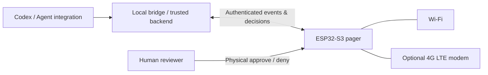

# 📟 Codex Pager 4G

**A pocket-sized, retro-style pager for supervising AI coding agents.**

> The AI works. The pager calls. The human decides.

**Project status:** 🟡 Concept / planning  
**Founded:** 24 October 2026  
**Hardware target:** ESP32-S3 + color display + buzzer + buttons + optional 4G LTE modem  
**Connectivity:** Wi-Fi first, cellular when available  
**Current phase:** Project definition; **not yet a working hardware or software implementation**.

## Why build this?

AI coding agents can run tasks autonomously, but users still need to monitor usage limits, review permission requests, and know when attention is needed. Checking an app's nested usage screen repeatedly is inconvenient. A dedicated physical device makes the most important information glanceable and keeps human approval under human control.

Codex Pager 4G reimagines a classic pager as a **human-in-the-loop companion** for an AI coding agent.

## Planned features

- **At-a-glance dashboard:** five-hour and weekly usage/remaining allowance, reset countdown, and any available reset actions, **only when legitimately exposed by the source system**.
- **Quota notifications:** retro *beep-beep-beep* on exhaustion (`😐🤲`), another alert when recovery is **confirmed** (`😋`).
- **Permission requests:** see the actual requested action and context; manually **Approve** or **Deny** each request. Denial reaction: `😭`.
- **Task status notifications:** pending, running, completed, blocked, failed.
- **Classic pager interface:** compact 3D-printed enclosure, physical keys, optional status LED, battery operation.
- **Two network paths:** ESP32-S3 Wi-Fi and optional cellular through a compatible 4G modem and SIM interface.
- **Low-data operation:** local countdown between syncs; compact events rather than continuous polling.

### The signature interaction

| Event | Alert | UI reaction |
|---|---|---|
| Five-hour allowance exhausted | Three retro beeps | `😐🤲` |
| Five-hour allowance confirmed replenished | Three retro beeps | `😋` |
| Permission needs review | Three retro beeps | `🥺` + command/details |
| Permission denied | Short feedback tone (TBD) | `😭` |
| Permission approved | Short feedback tone (TBD) | `😎` |

Notifications should be deduplicated to avoid repeated alerts; a countdown reaching zero **does not** by itself prove an allowance has reset.

## Proposed hardware (not final)

| Component | Candidate / requirement |
|---|---|
| MCU | ESP32-S3 (2.4 GHz Wi-Fi + BLE) |
| Display | ~1.5–2.0 inch color TFT, readable emoji graphics |
| Audio | Passive buzzer or small speaker; vintage three-beep pattern |
| Input | Physical navigation, approve and deny buttons, accidental-approval prevention |
| Cellular | 4G LTE Cat-1 bis class modem with UART/USB interface (model TBD) |
| SIM | Nano-SIM; eUICC adapter (5ber / ESTK) compatibility **to be tested** |
| Power | Rechargeable lithium battery, protected charging/power circuitry, low-power design |
| Enclosure | Custom 3D-printed 1990s-style pager with belt clip |

**Emoji design note:** Target an Apple-like visual experience where lawfully available, but do not redistribute Apple's proprietary emoji artwork in the repository. Display glyphs/assets must have suitable rights for redistribution.

## Architecture (proposal)



The integration may require a local companion app, supported hooks, or a custom bridge. **Do not assume that Codex exposes a remote approval or exact quota API.** A safe fallback is notification-only with approval on the computer.

## Human control is a feature

- Never automatically approve permission requests.
- Show the **exact action, scope, target, and relevant risk** before approval, not just a friendly summary.
- If the request cannot be reviewed fully on the screen, **require review on the computer**.
- Protect remote approval with authenticated, integrity-checked, single-use, expiring request IDs and explicit confirmation.
- Default to deny / no action when disconnected, expired, or uncertain.

See [Security principles](docs/security.md).

## Plan

1. **Phase 0 — Project charter:** scope, event definitions, architecture, risk list. *(In progress)*
2. **Phase 1 — Wi-Fi prototype:** display, emoji states, buzzer, buttons, mocked events.
3. **Phase 2 — Agent integration:** secure bridge, usage source, permission round trip where supported.
4. **Phase 3 — 4G connectivity:** modem selection, cellular reconnect, data and power measurements.
5. **Phase 4 — Enclosure:** 3D print, buttons, belt clip, PCB/power design.
6. **Phase 5 — Field test:** reliability, alert latency, battery, roaming, safety.

Detailed [roadmap](docs/roadmap.md), [requirements](docs/requirements.md), [architecture](docs/architecture.md), and [event contract](docs/event-protocol.md).

## Cellular data idea

A low-data cellular eSIM could make the device self-contained. Holafly Always On with an eUICC adapter is a **candidate for testing, not a verified modem-compatible or terms-compliant solution**. Confirm carrier/device terms, LTE bands, activation constraints, APN, roaming, and energy use before selecting a plan.

## Repository structure

```text
codex-pager-4g/
├── README.md
├── docs/
│   ├── architecture.md
│   ├── event-protocol.md
│   ├── requirements.md
│   ├── roadmap.md
│   └── security.md
├── firmware/README.md
├── backend/README.md
└── .github/ISSUE_TEMPLATE/
    ├── feature.yml
    └── research.yml
```

## License

**No license has been selected yet.** All rights reserved until the repository owner chooses a license. Opening an issue or pull request is not permission to reuse proprietary material.

---

**AI pages the human; the human stays in charge.** 📟
